# routing-configuration static and dynamic (RIP / EIGRP)

## STATIC :
the topology is 2 networks and link them with a 3d network between 2 routers :


configuring @IPs first then static routes after then testing : 

 left router :
 
  network 1 interface :
  
  
  
  gateway network interface :
  
  

  adding static route from network1 to network2 :

  

  testing this route with ping from pc2 192.168.10.2 to pc3 192.168.20.3 :
  
  

  final routing table :

  

   interfaces status :
  
  

  passwords setup example :
  
  

  
 right router :
 
  network 2 interface :
  
  
  
  gateway network interface :
  
  

  static route from 192.168.20.0 to 192.168.10.0 :

  
  
  test ping from pc3 in network2 to pc2 in network1 :

  

  final routing table :
  
  
  
   2nd example also preparation for rip :

   topology 
  
  

  one router interfaces set up example :
  
  

  i set up static routes , here is the network now and a test for the static routing :

  

## DYNAMIC :

### RIP v1

topology :


test after deleting all the static routes (nothing works anymore) :


all the subnets have the same mask (/24) so rip v1 is enough, no need for v2.

on each router i declare the serial links and its own lan only. `10.0.0.0` is class A so one line covers all the links :

```
router rip
 network 10.0.0.0
 network 192.168.x.0      (lan of this router)
```

router 1 :


router 2 :


router 3 :


router 4 :


router 5 :


routing table of router 4 after the routers updated their neighbors :


tests :

1. all routers up :


2. router r2 down :


3. router r4 (the one in the center) down :


the first packet failed but then the same packet worked because r5 received the updates from his neighbor r1 :


### RIP v2 (with VLSM)

rip v1 doesnt send the subnet mask, rip v2 does. so with subnets of different sizes (vlsm) only v2 works.

vlsm plan for 175.10.1.0/24 :

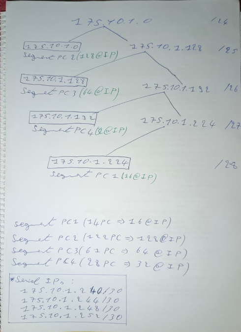

| segment | hosts | network | mask |
|---|---|---|---|
| pc2 (orange) | 122 | 175.10.1.0 | /25 |
| pc3 (violet) | 61 | 175.10.1.128 | /26 |
| pc4 (blue) | 28 | 175.10.1.192 | /27 |
| pc1 (green) | 14 | 175.10.1.224 | /28 |
| 4 links | 2 | 175.10.1.240 / .244 / .248 / .252 | /30 |

topology :

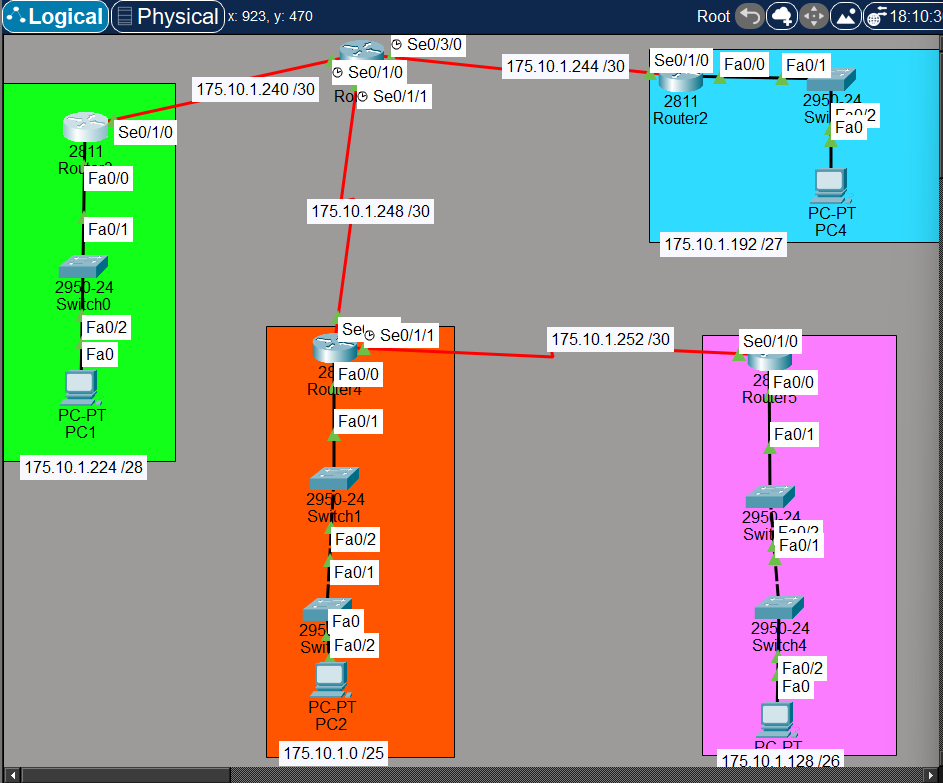

with rip v1 (`network 175.10.0.0` on every router) the pings fail :

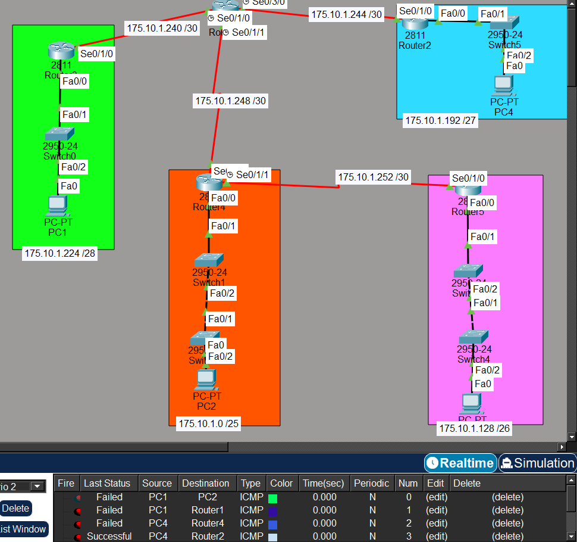

router 1 only learned one link (/30), no lan at all :

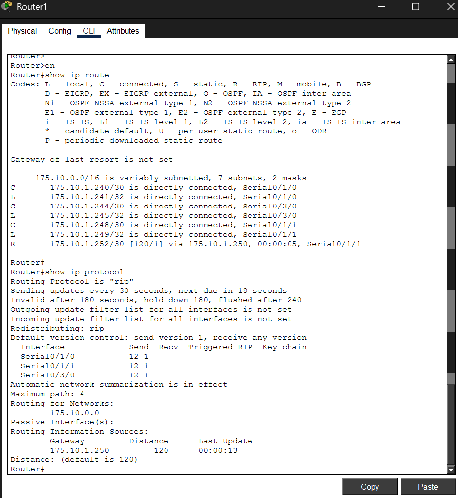

rip v2 : two lines added on all the routers, the network line stays the same :

```
router rip
 version 2
 no auto-summary
```

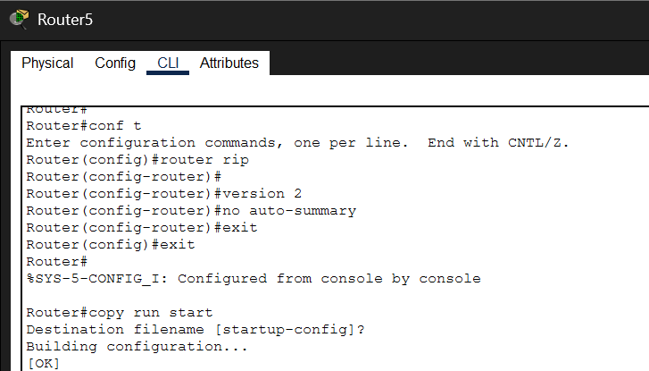

same network, same addresses, now everything works :

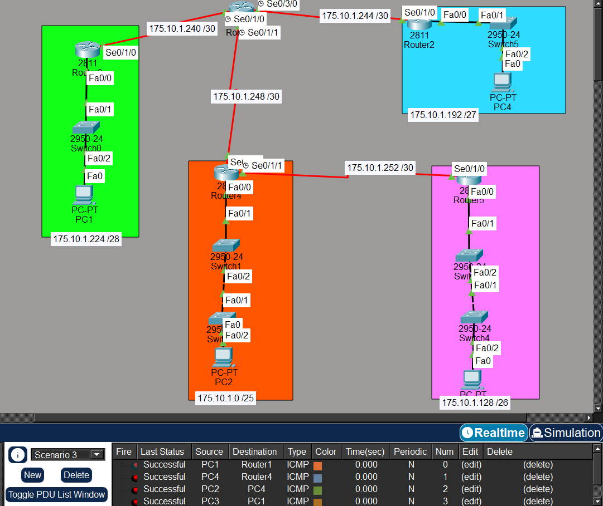

### EIGRP

same idea with vlsm, 201.60.34.0/23 split in 5 lans and 7 links (/30) :

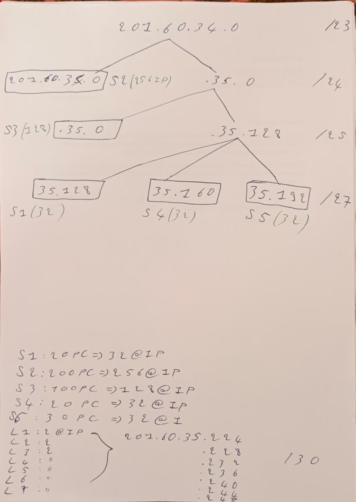

| segment | hosts | network | mask |
|---|---|---|---|
| s2 (pc2) | 200 | 201.60.34.0 | /24 |
| s3 (pc3) | 100 | 201.60.35.0 | /25 |
| s1 (pc1) | 20 | 201.60.35.128 | /27 |
| s4 (pc4) | 20 | 201.60.35.160 | /27 |
| s5 (pc5) | 30 | 201.60.35.192 | /27 |
| 7 links | 2 | 201.60.35.224 to .248 | /30 |

(the simulation labels show 210.60 instead of 201.60, typo)

topology :

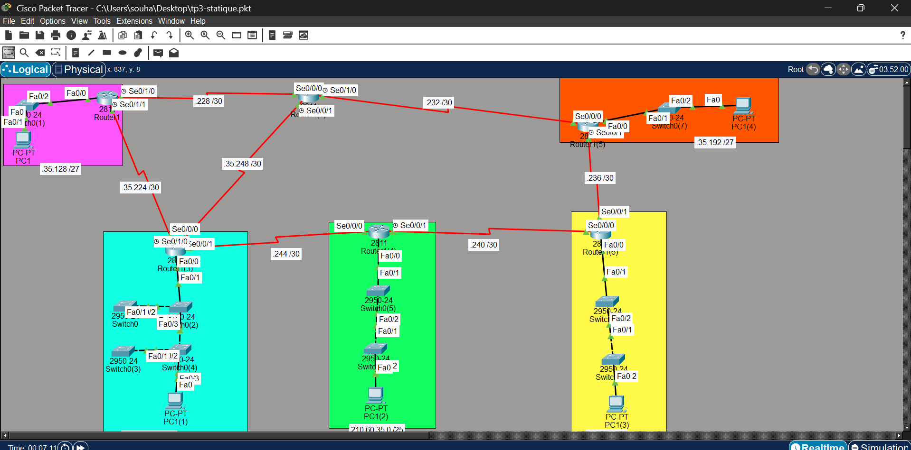

eigrp uses a wildcard mask in the network command (/24 = 0.0.0.255, /25 = 0.0.0.127, /27 = 0.0.0.31, /30 = 0.0.0.3). on each router : its lan and its links, same as rip, and the same AS number (100) everywhere :

```
router eigrp 100
 network 201.60.35.128 0.0.0.31     (lan)
 network 201.60.35.224 0.0.0.3      (link)
 network 201.60.35.228 0.0.0.3      (link)
 no auto-summary
```

pink router :

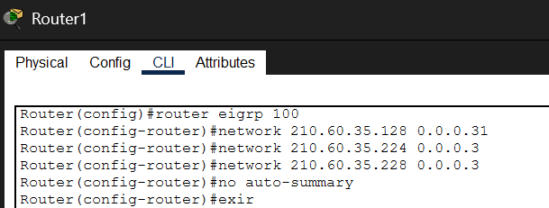

hub (no lan, 3 links) :

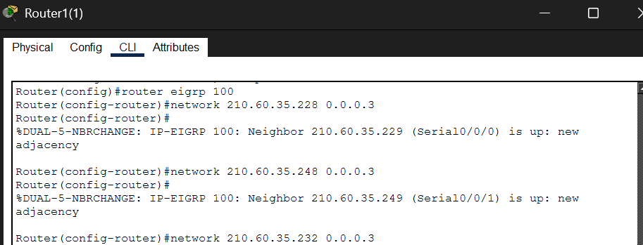

the neighbors show up as soon as 2 routers are configured (`%DUAL-5-NBRCHANGE ... is up`).

test :

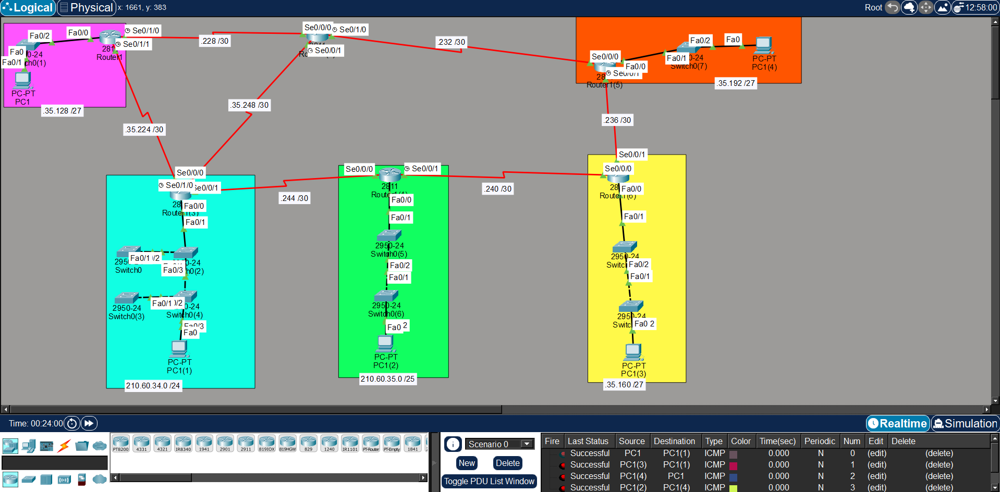

routing table of the pink router (`D` = eigrp learned routes) :

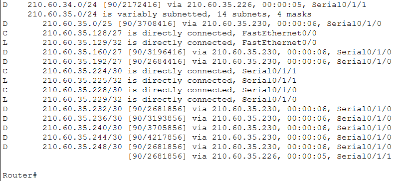
